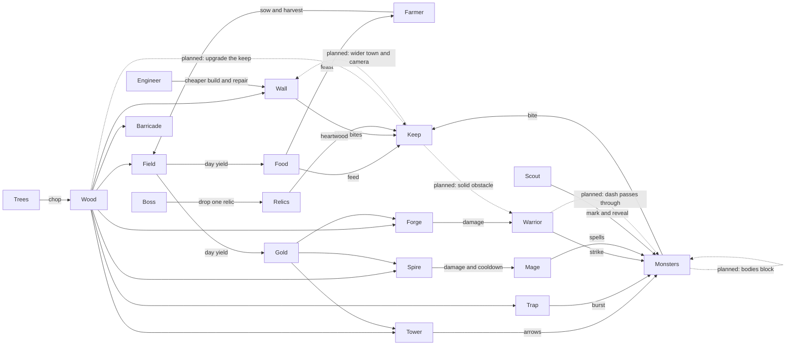

# Game interactions

This is the source of truth for how roles touch each other. The machine-readable graph is [`interactions.json`](interactions.json). `test/last_keep/game/interactions_test.exs` checks that file against `Rules` and the simulation source. If a rule changes, change the JSON in the same commit.

[`CONCEPT.md`](../CONCEPT.md) is the original pitch. Where this page and the concept disagree, the concept line is an edge marked `planned` in the JSON, and the gap is in [`playtests/BACKLOG.md`](../playtests/BACKLOG.md).

## Graph

## Roles

### Farmer

Actions: swing, sow a field for free, harvest nearby fields, feast. A farmer also pays 1 wood for a field instead of 4, and a living farmer doubles the food a field yields during the day.

Produces: fields, food, and the gold those fields trickle. Feast turns food back into hero health.

Who depends on it: anyone paying gold for a tower, forge, or spire, and anyone feeding the keep. Without a farmer the fields still yield, but sowing costs wood, the yield is half, and nobody can turn food into a party heal.

### Engineer

Actions: a swing that repairs the nearest building, a cheap wall, a cheap trap, and a barricade that lays three walls. Walls, towers, and traps cost the engineer less wood.

Produces: the physical line that monsters have to chew. Repair puts health back on that line.

Who depends on it: the keep. Any hero can place a wall, but without an engineer the same line costs more wood and nobody repairs it, so a breach stays open.

### Scout

Actions: a fast shot, a dash, mark, and a volley. Mark makes the target take more damage.

Produces: the early look at the next wave. While a scout is alive, the direction hints stay on screen before the last five seconds of the day.

Who depends on it: the builder who has to guess which side to wall. Without a scout the party only sees the next wave in the last five seconds, and marked targets are not softer.

### Warrior

Actions: strike, dash, guard, nova. A warrior kill pays one extra gold.

Produces: the melee answer to a monster that has reached the yard, a short guard against bites, and a little extra gold.

Who depends on it: the keep, when something is already inside the walls. Without a warrior the party still kills at range, but the body in the yard is gone and kills pay less gold.

Monsters that overlap push apart, so two goblins cannot stand inside one body. They still do not block a path. A hero still walks through another hero or a monster, and a wall line still cannot squeeze a pack into a gap. The warrior's dash is the planned exception that will pass through monsters once bodies block. Today `slide` and `chase` stop only for buildings.

### Mage

Actions: bolt, fireball, frost, meteor. Frost slows. Fireball and meteor burst.

Produces: ranged damage and a slow, so a pack can be thinned before it bites.

Who depends on it: the warrior who would otherwise meet the whole pack in melee. Without a mage the party has no burst and no slow. The spire does nothing useful unless a mage is in the room.

### Keep

The keep is the loss condition. Monsters bite it when they are closer to it than to a hero. Walls take that bite instead while they stand. Food spent beside the keep restores its health. Heartwood raises its maximum. When its health hits zero the run is over.

The keep is not a solid obstacle yet. `slide` has a flag for it, and every caller passes false, so heroes and monsters walk through the castle and bite it from inside. The planned edge makes the footprint solid: heroes stop at the wall, and monsters attack from the edge.

A keep upgrade is planned, not built. It spends wood and gold from gathering and fields, with no card pick. Each rank widens the radius in which the party can place buildings and pulls the camera back, so the town and the view grow together.

### Buildings

| Building | Costs | Why it exists |
| --- | --- | --- |
| Wall | Wood, less for an engineer | Stops a walker from reaching the keep |
| Tower | Wood and gold | Shoots a side the heroes are not watching |
| Trap | Wood | One large hit, then it is spent |
| Field | Wood, less for a farmer | Food and gold during the day |
| Forge | Wood and gold | 15% more damage while it stands |
| Spire | Wood and gold | Mages hit harder and recover faster |

### Monsters, elites, bosses, relics

Goblins, skeletons, wolves, and trolls walk at the keep or at the nearest hero and bite. Elites change that body: fast lunges, armored hits take less, enraged bites harder and sooner. A boss slams the keep harder. Killing any monster pays gold. Killing a boss also grants one relic the party does not hold: heartwood, whetstone, swiftness, banner, or granary.

Wave 1 is two slower, softer goblins from one direction, spawned about 136 to 147 units from the origin. Later nights spawn closer, about 108 to 125, then add directions, skeletons, wolves, trolls, elites, and bosses. Heroes stand near radius 120, so the first goblins arrive in the yard immediately. Pushing the spawn ring out and enlarging the map, while keeping the walk time fair, is planned. It is not in the simulation yet.

## Empty roles

No implemented role is isolated. Each hero has an outgoing edge in `interactions.json`, and each of wood, food, and gold has a producer and a consumer. The test fails if that stops being true.

Trees with wood are entities. A living hero standing on one chops it, and the tree leaves the world when the wood is gone. The client also draws a ring of trees that are not entities. They have no wood, so they cannot be chopped. They read as dead trees. Making them obviously scenery, or making them real trees, is planned.

## Planned, not in the simulation

Dotted arrows in the graph are these edges. They are `planned` in `interactions.json` and open in the backlog.

- Elites do not drop relics. Only a boss does.
- The spire does not unlock new spells. It only buffs the mage's damage and cooldowns.
- There is no city-growth layer. The party places each building by hand. The keep upgrade above is the first step of that idea, and it is not built either.
- Monsters push apart when they overlap. They still do not block a path, heroes do not block heroes, and heroes do not block monsters. A wall cannot funnel a pack yet.
- The warrior dash does not pass through monsters, because monsters are not obstacles.
- The keep is not solid.
- Spawn distance and the map size are still the current rings.
- The decorative tree ring is not a resource.
