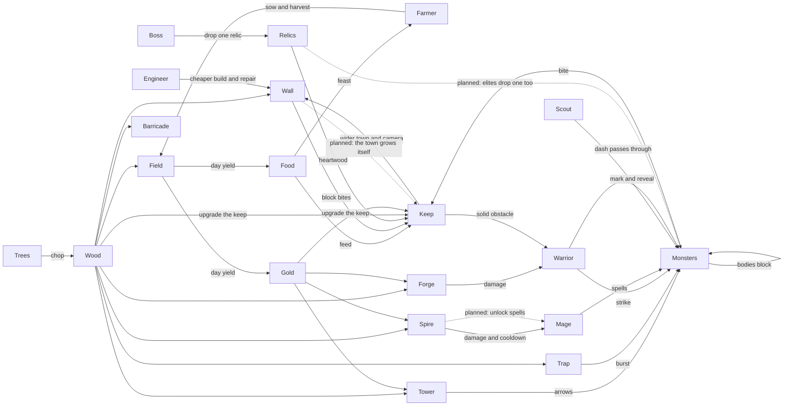

# Game interactions

This is the source of truth for how roles touch each other. The machine-readable graph is [`interactions.json`](interactions.json). `test/last_keep/game/interactions_test.exs` checks that file against `Rules` and the simulation source. If a rule changes, change the JSON in the same commit.

[`CONCEPT.md`](../CONCEPT.md) is the original pitch. Where this page and the concept disagree, the concept line is an edge marked `planned` in the JSON, and the gap is in [`playtests/BACKLOG.md`](../playtests/BACKLOG.md).

## Graph

## Roles

### Farmer

Actions: swing, sow a field for free, harvest nearby fields, feast. A farmer also pays 1 wood for a field instead of 4, and a living farmer doubles the food a field yields during the day.

Produces: fields, food, and the gold those fields trickle. Feast turns food back into hero health.

Who depends on it: anyone paying gold for a tower, forge, or spire, and anyone feeding the keep. Without a farmer the fields still yield, but sowing costs wood, the yield is half, and nobody can turn food into a party heal.

### Engineer

Actions: a swing that repairs the nearest building, a cheap wall, a cheap trap, and a barricade that lays three walls. Walls, towers, and traps cost the engineer less wood.

Produces: the physical line that monsters have to chew. Repair puts health back on that line.

Who depends on it: the keep. Any hero can place a wall, but without an engineer the same line costs more wood and nobody repairs it, so a breach stays open.

### Scout

Actions: a fast shot, a dash, mark, and a volley. Mark makes the target take more damage.

Produces: the early look at the next wave. While a scout is alive, the direction hints stay on screen before the last five seconds of the day.

Who depends on it: the builder who has to guess which side to wall. Without a scout the party only sees the next wave in the last five seconds, and marked targets are not softer.

### Warrior

Actions: strike, dash, guard, nova. A warrior kill pays one extra gold.

Produces: the melee answer to a monster that has reached the yard, a short guard against bites, and a little extra gold.

Who depends on it: the keep, when something is already inside the walls. Without a warrior the party still kills at range, but the body in the yard is gone and kills pay less gold.

Monsters that overlap push apart, and a monster also stops when the next step would enter another monster, a living hero, a wall, or the keep. A gap in a wall that fits one body and not two makes the pack file through. A hero stops on another hero and on a monster. The warrior's dash is the pass through a monster. A scout dash still stops. Walls, heroes, and the keep still stop the warrior dash.

### Mage

Actions: bolt, fireball, frost, meteor. Frost slows. Fireball and meteor burst.

Produces: ranged damage and a slow, so a pack can be thinned before it bites.

Who depends on it: the warrior who would otherwise meet the whole pack in melee. Without a mage the party has no burst and no slow. The spire does nothing useful unless a mage is in the room.

### Keep

The keep is the loss condition. Monsters bite it when they are closer to it than to a hero. Walls take that bite instead while they stand. Food spent beside the keep restores its health. Heartwood raises its maximum. When its health hits zero the run is over.

The keep is solid. A hero stops at the wall. A monster stops at the edge and bites from there. A monster that is already inside still bites.

Raising the keep spends wood and gold. The button is on the bar, and the hero has to stand beside the keep. There is no card pick. Rank 0 costs 24 wood and 8 gold. Each rank adds 12 wood and 6 gold, and the keep stops at rank 4. The build radius becomes the wider of the hero's kit range and 180 plus 48 per rank. The camera pulls back by 36 per rank, the dirt disc grows by 40, and the view scale grows by 0.12.

### Buildings

| Building | Costs | Why it exists |
| --- | --- | --- |
| Wall | Wood, less for an engineer | Stops a walker from reaching the keep |
| Tower | Wood and gold | Shoots a side the heroes are not watching |
| Trap | Wood | One large hit, then it is spent |
| Field | Wood, less for a farmer | Food and gold during the day |
| Forge | Wood and gold | 15% more damage while it stands |
| Spire | Wood and gold | Mages hit harder and recover faster |

### Monsters, elites, bosses, relics

Goblins, skeletons, wolves, and trolls walk at the keep or at the nearest hero and bite. Elites change that body: fast lunges, armored hits take less, enraged bites harder and sooner. A boss slams the keep harder. Killing any monster pays gold. Killing a boss also grants one relic the party does not hold: heartwood, whetstone, swiftness, banner, or granary.

Wave 1 is two slower, softer goblins from one direction, spawned about 620 to 659 units from the origin. Later nights spawn farther, about 760 to 839, then add directions, skeletons, wolves, trolls, elites, and bosses. Heroes stand near radius 120. The map clamps at 1800. A wave-1 goblin still has time to reach the keep inside the minute.

On screen the five heroes do not share a body. A warrior reads as broad shoulders and a shield, a mage as a robe, hat, and staff, a scout as a hood and a bow, a farmer as a straw brim and a fork, and an engineer as an apron and a hammer. Two monsters drawn on the same ground step apart, each with its own outline and bar, so a pair at the door is two bodies.

The night has its own sound. Day and building play one loop, the wave plays another, a horn marks the start, a sting marks the clear, and hits, kills, builds, keep bites, and the fall each have a cue. The mixer starts on the first click or key, and mute and volume stay on this machine. Nothing is loaded from another host.

## Empty roles

No implemented role is isolated. Each hero has an outgoing edge in `interactions.json`, and each of wood, food, and gold has a producer and a consumer. The test fails if that stops being true.

Trees with wood are entities. A living hero standing on one chops it, and the tree leaves the world when the wood is gone. Those trees are drawn with a green crown. The client also draws a ring of bare grey trunks. That ring is not an entity. It has no crown and no wood, so it cannot be chopped. `Rules.scenery_ring/0` says so.

## Planned, not in the simulation

Dotted arrows in the graph are these edges. They are `planned` in `interactions.json` and open in the backlog.

- Elites do not drop relics. Only a boss does.
- The spire does not unlock new spells. It only buffs the mage's damage and cooldowns.
- There is no city-growth layer beyond the keep upgrade. The party still places each building by hand.
