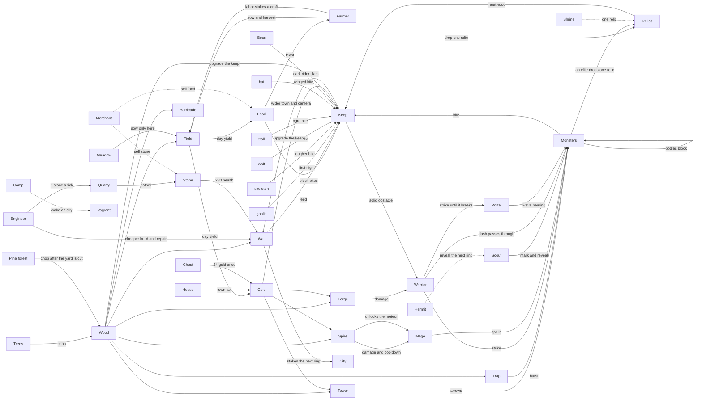

# Game interactions

This is the source of truth for how roles touch each other. The machine-readable graph is [`interactions.json`](interactions.json). `test/last_keep/game/interactions_test.exs` checks that file against `Rules` and the simulation source. If a rule changes, change the JSON in the same commit.

[`CONCEPT.md`](../CONCEPT.md) is the original pitch. Where this page and the concept disagree, the concept line is an edge marked `planned` in the JSON, and the gap is in [`playtests/BACKLOG.md`](../playtests/BACKLOG.md).

## Graph

## Roles

### Farmer

Actions: swing, sow a field for free, harvest nearby fields, feast. A farmer also pays 1 wood for a field instead of 4, and a living farmer doubles the food a field yields during the day.

Produces: fields, food, and the gold those fields trickle. Feast turns food back into hero health.

Who depends on it: anyone paying gold for a tower, forge, or spire, and anyone feeding the keep. Without a farmer the fields still yield, but sowing costs wood, the yield is half, and nobody can turn food into a party heal.

### Engineer

Actions: a swing that repairs the nearest building, a cheap wall, a cheap trap, and a barricade that lays three walls. Walls, towers, and traps cost the engineer less wood.

Produces: the physical line that monsters have to chew. Repair puts health back on that line.

Who depends on it: the keep. Any hero can place a wall, but without an engineer the same line costs more wood and nobody repairs it, so a breach stays open.

### Scout

Actions: a fast shot, a dash, mark, and a volley. Mark makes the target take more damage.

Produces: the early look at the next wave, and one extra ring of the shared map. While a scout is alive, the direction hints stay on screen before the last five seconds of the day. The extra ring is Chebyshev distance 2. A farmer still reveals the chunk underfoot and the eight neighbors.

Who depends on it: the builder who has to guess which side to wall. Without a scout the party only sees the next wave in the last five seconds, and marked targets are not softer.

### Warrior

Actions: strike, dash, guard, nova. A warrior kill pays one extra gold.

Produces: the melee answer to a monster that has reached the yard, a short guard against bites, and a little extra gold.

Who depends on it: the keep, when something is already inside the walls. Without a warrior the party still kills at range, but the body in the yard is gone and kills pay less gold.

Monsters that overlap push apart, and a monster also stops when the next step would enter another monster, a living hero, a wall, or the keep. A gap in a wall that fits one body and not two makes the pack file through. A hero stops on another hero and on a monster. The warrior's dash is the pass through a monster. A scout dash still stops. Walls, heroes, and the keep still stop the warrior dash.

### Mage

Actions: bolt, fireball, frost, meteor. Frost slows. Fireball and meteor burst.

Produces: ranged damage and a slow, so a pack can be thinned before it bites.

Who depends on it: the warrior who would otherwise meet the whole pack in melee. Without a mage the party has no burst and no slow. The spire does nothing useful unless a mage is in the room.

### Keep

The keep is the loss condition. Monsters bite it when they are closer to it than to a hero. Walls take that bite instead while they stand. Food spent beside the keep restores its health. Heartwood raises its maximum. When its health hits zero the run is over.

The keep is solid. A hero stops at the wall. A monster stops at the edge and bites from there. A monster that is already inside still bites.

Raising the keep spends wood and gold, and only while the hero stands inside radius 100 of the keep. Outside that radius the button stays on the bar, disabled, and a hover, a click, or a tap says "Walk to the keep". The phone context button does the same. The server refuses an out-of-range raise with those words. There is no card pick. Rank 0 costs 24 wood and 8 gold. Each rank adds 12 wood and 6 gold, and the keep stops at rank 4. The build radius becomes the wider of the hero's kit range and 180 plus 48 per rank. The camera pulls back by 36 per rank, the dirt disc grows by 40, and the view scale grows by 0.12.

Raising the keep stakes four timber houses on the new ring, paid by the wood and gold already spent. Each full ring of four mints one gold on the field-gold beat. A farmer's sow, harvest, or a four-second work pulse banks labor, and each point spends 1 wood to stake a wheat croft. No farmer, no croft. Rank 0 stakes nothing.

### Buildings

| Building | Costs | Why it exists |
| --- | --- | --- |
| Wall | Wood, less for an engineer | Stops a walker from reaching the keep |
| Tower | Wood and gold | Shoots a side the heroes are not watching |
| Trap | Wood | One large hit, then it is spent |
| Field | Wood, less for a farmer | Food and gold during the day |
| Forge | Wood and gold | 15% more damage while it stands |
| Spire | Wood and gold | Mages hit harder and recover faster |

### Monsters, elites, bosses, relics

Goblins, skeletons, wolves, and trolls walk at the keep or at the nearest hero and bite. Elites change that body: fast lunges, armored hits take less, enraged bites harder and sooner. A boss slams the keep harder. Killing any monster pays gold. Killing a boss also grants one relic the party does not hold: heartwood, whetstone, swiftness, banner, or granary.

Wave 1 is two slower, softer goblins, spawned about 620 to 659 units from the origin. Their bearings are the two nearest portals that still stand. Later nights spawn farther, about 760 to 839, and split that same count across the living portals. Heroes stand near radius 120. The map clamps at 7200. A wave-1 goblin still has time to reach the keep inside the minute. The rest of that land is [`concepts/WORLD.md`](concepts/WORLD.md).

On screen the five heroes do not share a body. A warrior reads as broad shoulders and a shield, a mage as a robe, hat, and staff, a scout as a hood and a bow, a farmer as a straw brim and a fork, and an engineer as an apron and a hammer. Two monsters drawn on the same ground step apart, each with its own outline and bar, so a pair at the door is two bodies.

The night has its own sound. Day and building play one loop, the wave plays another, a horn marks the start, a sting marks the clear, and hits, kills, builds, keep bites, and the fall each have a cue. The mixer starts on the first click or key, and mute and volume stay on this machine. Nothing is loaded from another host.

## Empty roles

No implemented role is isolated. Each hero has an outgoing edge in `interactions.json`, and each of wood, food, gold, and stone has a producer and a consumer. The test fails if that stops being true.

Trees with wood are entities. A living hero standing on one chops it, and the tree leaves the world when the wood is gone. Those trees are drawn as a layered pine: a wood trunk and stacked boughs. The client also draws seventy bare trunks in three rings. That ring is not an entity. It has no crown and no wood, so it cannot be chopped. `Rules.scenery_ring/0` says so.

A chest on the seeded land pays 24 gold the first time a living hero stands on it. The same spot pays nothing after that. A portal breaks under a strike. Night 1 stays two goblins, and the broken portal's bearing is not one of them.

## World edges

Solid arrows in the graph are in the simulation. Dotted arrows are still `planned` in `interactions.json`. The chest, the portal, the quarry, the meadow sow, the stone wall, and the pine chop are implemented. The camp, the shrine, the hermit, and the merchant stay planned. Generation stays off the hot tick. The numbers and the slice tests are [`concepts/WORLD.md`](concepts/WORLD.md). Stone is in the resource list.

Pine forest is the wood that refills a wall line after the yard trees are cut. Any living hero chops a pine that still has wood. Each pine holds 12. A yard tree within 48 takes the chop instead. The seventy bare trunks stay bare.

A quarry is the engineer's walk. It holds 40 stone. An engineer takes 2 per work tick and any other living hero takes 1. The stock caps at 200. A stone wall costs 8 stone and 4 wood and has 280 health, because a troll bite eats a wood wall. A wood wall stays 8 wood, or 4 for an engineer, at 170 health.

A field can be sown only on meadow. Pine, ruins, river, ford, and cliff refuse the sow and spend nothing. The keep disc is meadow, so the crofts already staked in the yard still place. Meadow outside that disc is why a farmer leaves the yard.

A chest holds 24 gold, once. Field gold stays the small daytime mint. The chest is the hoard that pays a keep raise. A living scout reveals one extra chunk ring, which is how the party finds the next chest before the day ends. The discovered set is one set for the room. A chest in a hidden chunk is absent from the snapshot. The map table at (0, 160) shows the explored chunks to a hero within 80. Off screen, the nearest revealed portal and the nearest unopened chest use the same edge beacon as the next wave.

A portal is a wave origin. Destroying it removes its bearing from the next plan and claims that portal's chunk. The keep disc of radius 400 stays held. A build inside the hero's reach and outside both of those fails with "The land is not held." A barricade whose three sites are all outside that land spends no wood and does not start its cooldown. A field on held pine still needs meadow. Raising the keep widens the town and the build reach. It does not claim the map. Wave 1 stays two goblins. A camp spends 8 gold to wake one ally who does not take a seat. A shrine grants one relic the party does not hold. A merchant sells food or stone for gold. A hermit reveals the next chunk ring.
